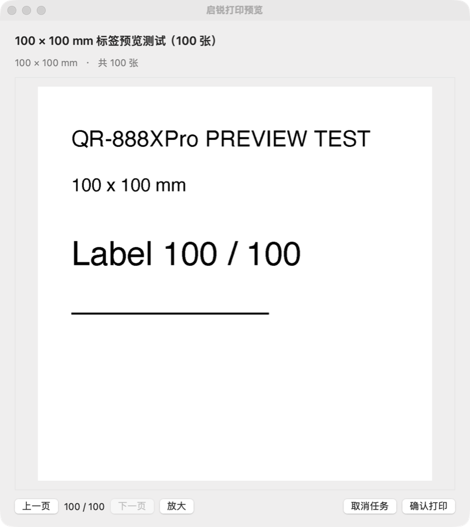

# QR888 Bluetooth Bridge

在 Mac 上给启锐 QR-888XPro 提供系统打印队列。浏览器、PDF 阅读器和卖家客户端可从各自的打印窗口提交标签。打印桥会显示驱动生成的黑白预览，点「确认打印」才通过蓝牙发送。

<p align="center"></p>

## 适用范围

- **打印机** · 启锐 QR-888XPro。其他型号和不同固件的兼容性需要单独验证。
- **Mac** · 提供 Apple Silicon 和 Intel 通用二进制。App 最低构建目标是 macOS 11。当前的系统队列、预览和蓝牙测试在 Apple Silicon Mac 上进行，Intel 和较旧系统需要实机检验。
- **驱动** · 需要启锐 macOS 驱动及其中的 `QR-888XPro.ppd`。从官网下载「启锐MacOS驱动」并按厂商说明安装。 [启锐下载中心](https://qrprt.com/download.html)
- **标签纸** · 内置 100 × 100 mm 默认纸型，其余纸型由驱动提供。在打印窗口选和卷纸一致的尺寸。

## 快速开始

从 [GitHub Releases](https://github.com/chenyutaoMike/qr888-bluetooth-bridge/releases) 下载 DMG 和对应的 SHA-256 文件。

1. 装好启锐驱动。打开打印机和 Mac 的蓝牙。如果标签管家正在连接，先断开它与打印机的连接。
2. 打开 DMG，把 **QR888 Bluetooth Bridge** 拖进「应用程序」，再从「应用程序」双击打开。macOS 弹出蓝牙授权时，允许该 App 查找打印机。
3. 点「添加打印机」，选择列表里的 QR-888XPro。同型号设备有多台时，核对蓝牙名称或先只打开目标打印机。以后可在菜单栏「启锐 → 选择蓝牙打印机」重新选择。
4. 在菜单栏「启锐」打开 **100 × 100 mm 测试标签**。按 `⌘P`，选 **启锐 QR-888XPro 蓝牙**，纸张选 **100 × 100 mm**，提交任务。弹出标签预览后，可以翻页、放大，或直接取消。检查无误后点「确认打印」。

**本地试用 DMG** 使用临时签名。下载后 macOS 可能阻止首次启动。仅在确认来源可信且 SHA-256 相符后，可按 Apple 指引为这一个 App 选择「仍要打开」。受管控的 Mac 可能需要管理员协助。签名和公证的维护者步骤见[打包与发布](docs/release.md)。 [Apple 的安全打开说明](https://support.apple.com/zh-cn/102445)

## 日常使用

| 操作 | 在哪里做 |
| --- | --- |
| 更改纸张、方向、缩放和份数 | 提交前在原 App 的打印窗口调整 |
| 查看每张标签和总数 | 「启锐打印预览」里的上一页、下一页和放大 |
| 暂时关闭预览 | 点窗口关闭按钮。菜单栏「启锐 → 查看待预览任务」可以重新打开 |
| 跳过本批标签 | 点「取消任务」 |
| 更换设备或核对连接 | 菜单栏「启锐 → 选择蓝牙打印机」或「检查蓝牙连接」 |

一次提交的一批标签共用一次确认。多批任务按接收顺序预览。单个任务最多接收 16 MiB 的驱动输出，能装下多少页取决于每页的内容。较大的批次可以拆开提交。

打印桥用本机 CUPS 队列接收作业。系统打印队列显示完成后，打印桥仍可能在等待确认。已开始发送的任务如果中断，请查看实际出纸，再决定重打哪些标签。

## 常见问题

### App 开了但找不到打印机队列

先看菜单栏是否出现「启锐」，然后选择「设置系统打印机」。驱动安装完成后可以再次使用这个入口。若已有旧版打印桥占用本机端口，先从菜单退出旧版再打开新版。新版可复用指向同一桥接地址的原有队列。

### 能看到队列，但搜索不到蓝牙打印机

打开打印机、让它靠近 Mac，断开正在占用打印机的标签管家，并到「系统设置 → 隐私与安全性 → 蓝牙」检查授权。重新点「选择蓝牙打印机」。选好以后可以用「检查蓝牙连接」验证接口，这一步不出纸。

### 预览裁边、方向不对或尺寸不合适

取消当前任务。回原 App 的打印窗口选对纸型和方向。标签 PDF 本身就是 100 × 100 mm 时可以先选实际尺寸。A4 页面需要另行检查缩放后条码和文字是否完整。

### 怎样登录后自动打开

在「系统设置 → 通用 → 登录项」中添加这个 App。它随后在菜单栏运行。

### 怎样卸载

从「启锐」菜单退出打印桥。在「系统设置 → 打印机与扫描仪」移除这条蓝牙队列，再从「应用程序」移除 App。如曾添加登录项，一并移除。待预览文件在 `~/Library/Application Support/QR888OpenBridge/Pending/`，日志在 `~/Library/Logs/QR888OpenBridge/`，可自行备份或清理。

## 开发与许可

```bash
xcode-select --install
./scripts/test.sh
./scripts/build.sh universal
```

编译产物位于 `build/`。Swift 源码调用系统的 AppKit、CoreBluetooth、Network、CoreGraphics 和 zlib。打印桥仅监听 `127.0.0.1:19150`。待确认的驱动位图暂存在当前用户的本机目录，预览与打印均在本机处理。此项目是独立社区工具。

本项目的源码和文档采用 [MIT License](LICENSE)。厂商提供的驱动及打印机名称属于各自权利人。驱动通过厂商渠道单独安装。

- [构建、签名和发布](docs/release.md)
- [系统队列与打印流程](docs/architecture.md)
- [100 × 100 mm 样张](Examples/test-label-100x100.pdf)
